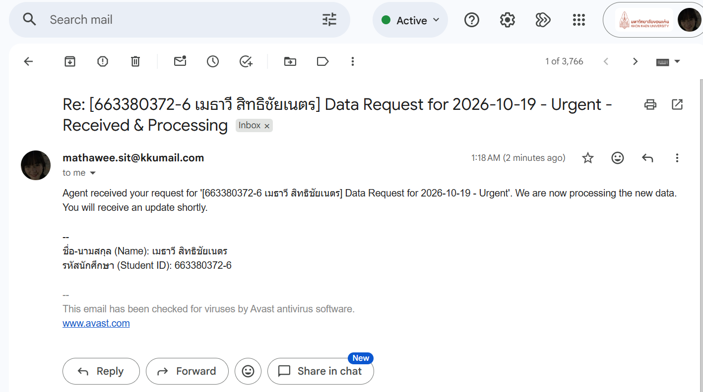

# Week12_LabX ADV_663380372-6
## Agentic Communication Workflows (Advanced Email & SMS)

ผู้จัดทำ: เมธาวี สิทธิชัยเนตร, รหัสนักศึกษา 663380372-6

**CommunicationAgent** อ่าน workflow จาก `configs/comm_pipeline_config.json` แล้วรันทีละ task เติมเนื้อหาอีเมลและ SMS จาก **context** ของ agent ผ่าน template ประมวลผลกล่องจดหมายตาม **if-then rules** และบันทึกทุกขั้นตอนลง audit report

## 📸 Screenshot: อีเมลจากการรันโค้ด


## Workflow (ตาม config)
| # | Task | Type | ผลลัพธ์ |
|---|---|---|---|
| 1 | Send Daily Sales Report Email | `send_email` | ส่งรายงาน (To + CC) แนบ `sales_report.pdf` และ `summary_data.xlsx` subject/body สร้างจาก template |
| 2 | Send Sales Alert SMS | `send_sms` | ส่ง SMS ผ่าน email gateway (ค่ายในไทยไม่มี gateway จึงข้ามและ log WARNING) |
| 3 | Simulate Incoming Request Email | `send_email` | ส่งอีเมล "Data Request ... - Urgent" พร้อมไฟล์แนบให้ตัวเอง |
| 4 | Process Incoming Data Requests | `process_inbox` | ค้นหา UNSEEN จากตัวเอง ที่ subject มี "Data Request" แล้วดาวน์โหลดไฟล์แนบลง `data/incoming_attachments/` และ mark as read |

Rules ในขั้นที่ 4 มี 2 ข้อ
- **Rule 1:** subject มี "Urgent" และมีไฟล์แนบ → ส่ง SMS alert
- **Rule 2:** body มี "new data processing" → ตอบกลับอัตโนมัติ "Re: ... - Received & Processing"

ทุกอีเมลมี `[รหัสนักศึกษา ชื่อ-นามสกุล]` ใน subject และมีชื่อกับรหัสท้ายเนื้อหา

## วิธีรัน
```bash
python -m venv venv
venv\Scripts\activate                # macOS/Linux: source venv/bin/activate
pip install -r requirements.txt
copy .env.example .env               # แล้วแก้ค่าใน .env (macOS/Linux: cp)
python create_sample_files.py        # สร้างไฟล์แนบตัวอย่าง (มีให้แล้วใน repo)
python main.py
```

`.env` ต้องมีค่าเหล่านี้
- `SENDER_EMAIL` และ `SENDER_APP_PASSWORD`: ต้องเป็น **Gmail App Password** ไม่ใช่รหัสผ่านปกติ
- `SMTP_SERVER`, `SMTP_PORT`, `IMAP_SERVER`
- `TEST_RECIPIENT_EMAIL`, `TEST_SMS_PHONE_NUMBER`, `TEST_SMS_CARRIER`
- `STUDENT_NAME`, `STUDENT_ID`

ไฟล์ `.env` ไม่ถูก commit ขึ้น GitHub เพราะกันไว้ใน `.gitignore`

## Template syntax
- `${ENV_VAR}`: ค่าจาก `.env` เช่น `${SENDER_EMAIL}`
- `{key}`: ค่าจาก context ของ agent เช่น `{report_date}` หรือ `{sales_figure:,.2f}`
- ใน rule actions ใช้ค่าของอีเมลที่เข้ามาได้ด้วย เช่น `{subject}`, `{sender}`, `{attachments_meta[0][filepath]}`

## Project Structure
```
Week12_LabX ADV_663380372-6/
├── src/
│   ├── __init__.py
│   ├── communication_agent.py   # Agent: dispatch tasks, context, rules, audit
│   ├── email_tasks.py           # SMTP send (To/CC/BCC, attachments) + IMAP search/fetch
│   ├── sms_tasks.py             # SMS via email-to-SMS gateway
│   ├── config_parser.py         # โหลดและ validate config
│   ├── template_renderer.py     # ${ENV} + {context} templates
│   └── utils.py                 # logging, .env, audit helpers
├── configs/
│   └── comm_pipeline_config.json
├── data/
│   ├── attachments/
│   ├── reports/
│   │   ├── sales_report.pdf
│   │   └── summary_data.xlsx
│   └── incoming_attachments/    # ไฟล์แนบที่ดาวน์โหลดจากอีเมล
├── screenshots/
├── .env.example
├── create_sample_files.py
├── main.py
├── requirements.txt
├── .gitignore
└── README.md
```

## สิ่งที่แก้จาก starter code (เดิมรันไม่ผ่าน)
1. **`main.py`**: เปลี่ยนเป็น `from src.... import ...` เพราะโมดูลใน `src/` ใช้ relative import
2. **`config_parser.py`**: เดิมเช็ค `parameters.to` แต่ config ใช้ `parameters.recipients.to` ทำให้ validation ไม่ผ่านเสมอ จึงแก้ให้ตรงกับ config
3. **`template_renderer.py`**: config ใช้ `${TEST_RECIPIENT_EMAIL}` แต่ renderer เดิมใช้ `str.format` ซึ่งอ่านค่าจาก `.env` ไม่ได้ (เกิด KeyError) จึงเพิ่มการแทนค่า `${ENV_VAR}` จาก environment ก่อน
4. **config `alert_message_template`**: `{attachments_meta.0.filepath}` ไม่ใช่ syntax ของ `str.format` จึงเปลี่ยนเป็น `{attachments_meta[0][filepath]}`
5. **`email_tasks.py`**: subject และ body เป็น UTF-8 รองรับภาษาไทย, ใช้ IMAP UID จริง (`uid('search'/'fetch'/'store')`) และใส่ `"..."` ครอบค่าที่ใช้ค้นหา
6. **`process_inbox`**: เพิ่ม `wait_before_search_seconds` รอให้อีเมลที่เพิ่งส่งเข้ากล่องก่อนค้นหา
